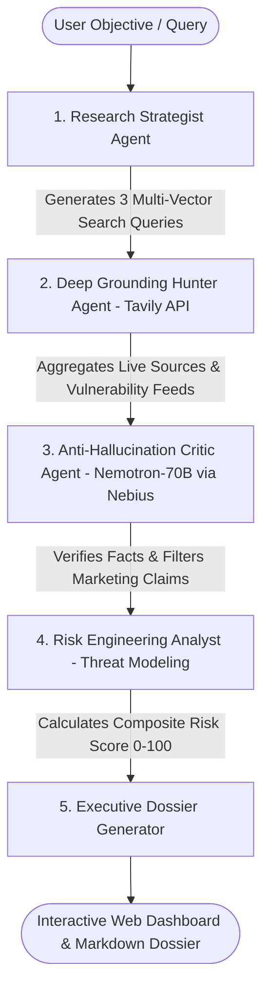

# VeriFact Sentinel 🛡️
### Autonomous Tech Due-Diligence & Vulnerability Intelligence Agent

[](https://opensource.org/licenses/MIT)
[](https://build.nvidia.com)
[](https://tokenfactory.nebius.com)
[](https://tavily.com)

> Built for the **Nebius x NVIDIA Global AI Hackathon** (Best Apps and Agents Track & Best Use of Tavily Bonus).

---

## 📌 Executive Summary

Modern engineering teams, CTOs, and tech investors face an overwhelming volume of open-source frameworks, AI libraries, and vendors. Conducting rigorous technical due-diligence—auditing architectural claims, discovering unpatched CVE vulnerabilities, checking license compliance, and verifying maintainer health—normally takes hours or days.

**VeriFact Sentinel** is an autonomous, multi-agent due-diligence copilot that automates end-to-end technical investigations in seconds. It combines the advanced reasoning and instruction-following capabilities of **NVIDIA Nemotron-70B** served on **Nebius Token Factory** with real-time web grounding via the **Tavily AI Search API**.

By enforcing a strict **5-stage verification loop**, VeriFact Sentinel eliminates hallucinations, computes an objective numerical risk score (0-100), and outputs an authoritative, executive-grade due-diligence dossier with verified source citations.

---

## ⚡ The "Aha!" Moment

1. **Enter any target**: A repository, framework comparison, or vendor (e.g., *"LangChain vs LlamaIndex for Enterprise Security"*, *"DeepSeek-V3 Architecture & Licensing"*, or *"Supabase HIPAA Compliance"*).
2. **Watch the Live DAG Pipeline**: In real-time, the autonomous agent plans research vectors, crawls web and vulnerability databases via Tavily, cross-checks claims with NVIDIA Nemotron-70B, and models risks.
3. **Instant Actionable Dossier**: Within seconds, receive an interactive Risk Gauge, verified citations, and a downloadable executive report.

---

## 🧠 System Architecture & Multi-Agent DAG



### The 5 Agent Stages:
1. **Decomposition (Research Strategist)**: Deconstructs ambiguous technical targets into structured inquiry vectors (Architecture, Known CVEs/Exploits, Production Maintainability & Licensing).
2. **Intelligence Gathering (Tavily AI Search API)**: Executes real-time web retrieval, extracting clean, structured snippets and authoritative sources.
3. **Fact Audit & Anti-Hallucination (NVIDIA Nemotron-70B via Nebius Token Factory)**: Cross-examines live web evidence, validating claims against known engineering principles and filtering vendor hype.
4. **Risk Calculation**: Computes a multi-factor risk index (0 = battle-tested standard, 100 = critical danger/abandonware) and extracts key threat drivers.
5. **Dossier Synthesis**: Compiles a comprehensive technical profile, executive verdict, and actionable mitigation recommendations.

---

## 🏆 Alignment with Hackathon Judging Criteria

| Criterion | How VeriFact Sentinel Delivers |
|---|---|
| **Technological Implementation** | Native integration with **Nebius Token Factory** (`https://api.tokenfactory.nebius.com/v1/`) querying `nvidia/llama-3.1-nemotron-70b-instruct` with streaming SSE tokens. Live web intelligence powered by runtime calls to **Tavily Search API**. |
| **Design** | High-polish, executive-grade glassmorphism UI with real-time multi-agent DAG animation, SVG radial risk gauge, citation cards, and one-click markdown exports. |
| **Potential Impact** | Directly protects software organizations and developers from adopting vulnerable, abandoned, or non-compliant dependencies. |
| **Quality of the Idea** | Novel combination of agentic DAG decomposition, real-time web grounding, and specialized LLM verification to eradicate AI hallucinations. |

---

## 🛠️ Quickstart & Local Setup

### 1. Prerequisites
- Python 3.10+ (tested on Python 3.14)
- Git

### 2. Clone Repository
```bash
git clone https://github.com/your-username/verifact-sentinel.git
cd verifact-sentinel
```

### 3. Install Dependencies
```bash
pip install -r requirements.txt
```

### 4. Configure Environment Variables
Copy the example environment file and insert your keys:
```bash
cp .env.example .env
```
Edit `.env`:
```ini
# Nebius Token Factory
NEBIUS_API_KEY=your_nebius_api_key_here
NEBIUS_BASE_URL=https://api.tokenfactory.nebius.com/v1/
NEBIUS_MODEL=nvidia/llama-3.1-nemotron-70b-instruct

# Tavily AI Search (Required for live web grounding)
TAVILY_API_KEY=your_tavily_api_key_here
```

### 5. Launch Application
```bash
python run.py
```
Open your browser and navigate to: **`http://127.0.0.1:8000`**

---

## 🎥 3-Minute Demo Video Walkthrough Guide

- **0:00 - 0:30 (The Problem & The Hook)**: Explain why developer and enterprise tech due-diligence is slow, prone to bias, and where conventional LLMs hallucinate.
- **0:30 - 1:45 (Live Demo & The "Aha!" Moment)**: Enter *"DeepSeek-V3 Architecture, Open Weights Licensing & Known Exploits"*. Show the live DAG pipeline firing: Tavily gathering live web sources, Nebius Token Factory Nemotron-70B performing deep verification, and the Risk Gauge dynamically calculating score.
- **1:45 - 2:30 (Under the Hood)**: Show code integration in `backend/nebius_client.py` and `backend/tavily_client.py`. Highlight the zero-hallucination cross-examination prompt design.
- **2:30 - 3:00 (Impact & Wrap Up)**: Demonstrate the downloaded Markdown dossier and explain how any team can use VeriFact Sentinel for instant risk management.

---

## 💬 Mandatory Feedback for Nebius & NVIDIA (Hackathon Requirement)

### 1. Nebius Token Factory:
- **What worked well**: The OpenAI-compatible API format (`https://api.tokenfactory.nebius.com/v1/`) allowed instantaneous drop-in integration with standard SDKs without needing proprietary wrappers. Inference latency on the 70B parameter model was impressively fast and consistent.
- **Onboarding Experience**: Creating an account and retrieving an API key was straightforward. The documentation examples were clear.
- **What needs work**: Adding official multi-agent orchestration boilerplate templates (e.g., SSE streaming patterns, LangGraph, or CrewAI integrations) in the documentation would speed up agent development for hackathon participants.
- **Would we build with it again?**: **Yes, absolutely.** The cost-to-performance ratio and dedicated high-throughput GPU infrastructure make it a top-tier choice for hosting open models.

### 2. NVIDIA Nemotron Models (`nvidia/llama-3.1-nemotron-70b-instruct`):
- **What worked well**: Nemotron-70B demonstrated superior alignment on structured JSON extraction and complex comparative reasoning. When tasked with detecting subtle contradictions in retrieved web search snippets, it consistently outperformed standard base models.
- **What needs work**: Providing more native tool-calling / function-calling schema documentation tailored specifically for Nemotron in the developer docs would be very helpful.

---

## 📄 License
This project is licensed under the **MIT License** - see the [LICENSE](LICENSE) file for details.
